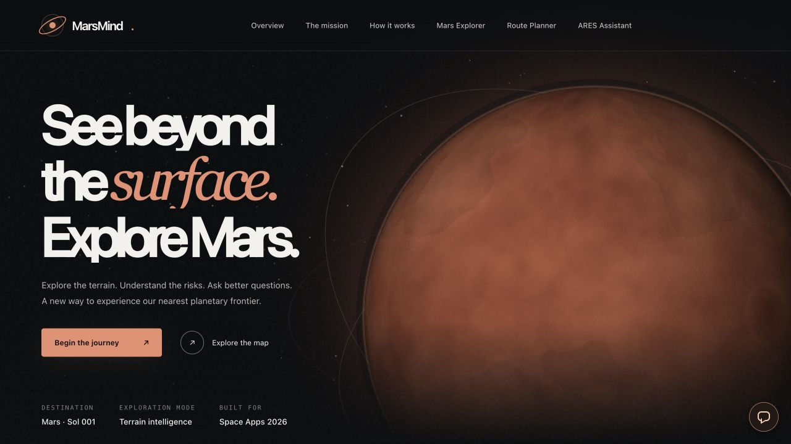

# 🚀 Mars Mind (NASA Space Apps 2026)

**[Open the live demo](https://mars-mind-spaceapps2026.vercel.app/)**

[](https://mars-mind-spaceapps2026.vercel.app/)

[](https://fastapi.tiangolo.com)
[](https://react.dev)
[](https://www.typescriptlang.org)
[](https://www.python.org)

Mars Mind is an autonomous planetary exploration and habitat management platform developed for the NASA Space Apps Challenge 2026. It couples planetary environmental telemetry with an onboard conversational AI specialist (**ARES**) to guide astronauts and mission engineers on surface operations, life support (ECLSS), and communication windows.

---

## 🏛️ Project Architecture: 3 Core Pillars

The application is structured into three clean, decoupled components:

```
Mars-Mind-spaceapps2026/
├── backend/                  # 1. PYTHON BACKEND (BE)
│   ├── app/
│   │   ├── main.py           # FastAPI entrypoint & CORS middleware
│   │   ├── config.py         # App configuration & environment settings
│   │   ├── models/           # Pydantic request/response schemas
│   │   │   └── chat.py
│   │   ├── routers/          # Modular API endpoints
│   │   │   ├── health.py     # GET /api/health
│   │   │   └── chat.py       # POST /api/chat, GET /api/chat/suggestions
│   │   └── services/         # Mission business logic & AI orchestration
│   │       └── chatbot_service.py # Intelligent knowledge graph & LLM bridge
│   ├── tests/                # Automated API & unit tests
│   │   └── test_chat.py
│   ├── requirements.txt      # Python dependencies
│   ├── .env.example
│   └── README.md
│
├── frontend/                 # 2. REACT FRONTEND (FE)
│   ├── src/
│   │   ├── components/
│   │   │   ├── Navbar.tsx             # Header with live BE status indicator & tab navigation
│   │   │   ├── MissionOverview.tsx    # Surface environment, ECLSS & rover telemetry cards
│   │   │   └── Chatbot/               # 3. CHATBOT FEATURE
│   │   │       ├── ChatbotWidget.tsx  # Central chat panel container
│   │   │       ├── MessageList.tsx    # Message thread & typing indicator
│   │   │       ├── MessageItem.tsx    # Bubble renderer with formatting & quick replies
│   │   │       └── ChatInput.tsx      # Prompt input bar & suggestion chips
│   │   ├── services/
│   │   │   └── api.ts                 # Typed fetch client connecting to FastAPI
│   │   ├── types/
│   │   │   └── chat.ts                # TypeScript interfaces
│   │   ├── App.tsx                    # Top-level shell with tab navigation & slide-out drawer
│   │   ├── App.css                    # NASA space-themed styling & responsive layouts
│   │   ├── index.css                  # CSS variables & typography
│   │   └── main.tsx                   # React root entrypoint
│   ├── package.json
│   ├── tsconfig.json
│   ├── vite.config.ts                 # Proxies /api requests to http://127.0.0.1:8000
│   ├── .env.example
│   └── README.md
│
├── CHATBOT_FEATURE.md        # Comprehensive Chatbot feature specifications & architecture
├── DEVELOPMENT.md            # Detailed developer guide & workflow reference
└── README.md                 # Primary project documentation
```

### 1. Python Backend (`/backend`)
- Built with **FastAPI** for high throughput and native async request execution.
- Automatically serves OpenAPI Swagger documentation at `/docs`.
- Health check monitoring at `/api/health` with CORS support for seamless local and cloud deployments.

### 2. React Frontend (`/frontend`)
- Built with **React 18**, **TypeScript**, and **Vite** for sub-second hot reloading.
- Surface Telemetry Dashboard displaying Jezero Crater ambient parameters, ECLSS habitat oxygen/water reserves, autonomous rover battery and AutoNav metrics, and Deep Space Network (DSN) comms latency.
- Embedded system status pill checking backend uptime in real time.

### 3. Onboard AI Chatbot Feature (`ARES`)
- **Backend Service (`chatbot_service.py`)**: Knowledge engine handling Mars science, atmospheric extraction (MOXIE), radiation defense, life support recycling, and communication delays. Includes fallback mock engine and modular extension points for Gemini, OpenAI, or local LLMs.
- **Frontend Interface (`ChatbotWidget.tsx`)**: Available as both a dedicated full-screen tab and a floating slide-out drawer accessible from any dashboard screen. Features typing indicators, multi-turn dialogue history, quick suggestion chips, and error resilience.
- **Detailed Specifications**: See the complete [CHATBOT_FEATURE.md](file:///c:/Users/fatima/Downloads/nasa-2026/Mars-Mind-spaceapps2026/CHATBOT_FEATURE.md) for full architecture diagrams, SSE streaming specs, voice STT/TTS capabilities, and telemetry schema.

---

## 🛠️ Prerequisites

Ensure you have the following installed on your workstation:
- **Python**: Version 3.10 or higher (`python --version`)
- **Node.js**: Version 18.0 or higher (`node --version`)
- **npm**: Version 9.0 or higher (`npm --version`)

---

## 🚀 Quick Start Guide (Installing & Running)

Follow these steps to set up both Backend and Frontend locally.

### Step 1: Clone the Repository
```bash
git clone https://github.com/your-org/Mars-Mind-spaceapps2026.git
cd Mars-Mind-spaceapps2026
```

---

### Step 2: Set Up & Run the Python Backend

Open a terminal in the project root:

```bash
# Navigate to the backend directory
cd backend

# 1. Create a virtual environment
# Windows:
python -m venv .venv
.venv\Scripts\activate

# macOS / Linux:
python3 -m venv .venv
source .venv/bin/activate

# 2. Install dependencies
pip install -r requirements.txt

# 3. (Optional) Configure environment variables
# Windows:
copy .env.example .env
# macOS / Linux:
cp .env.example .env

# 4. Start the FastAPI development server
python -m uvicorn app.main:app --reload --host 127.0.0.1 --port 8000
```

Backend will now be live:
- **API Base:** [http://127.0.0.1:8000](http://127.0.0.1:8000)
- **Interactive Swagger Docs:** [http://127.0.0.1:8000/docs](http://127.0.0.1:8000/docs)
- **Health Check:** [http://127.0.0.1:8000/api/health](http://127.0.0.1:8000/api/health)

---

### Step 3: Set Up & Run the React Frontend

Open a **second terminal** in the project root:

```bash
# Navigate to the frontend directory
cd frontend

# 1. Install dependencies
npm install

# 2. (Optional) Configure environment variables
# Windows:
copy .env.example .env
# macOS / Linux:
cp .env.example .env

# 3. Start the Vite development server
npm run dev
```

Frontend will now be running:
- **Web App:** [http://localhost:5173](http://localhost:5173)

*(Requests to `/api/*` are automatically proxied by Vite to the backend on `http://127.0.0.1:8000`)*

---

## 🤖 Chatbot API Endpoints

| Method | Endpoint | Description |
|---|---|---|
| `GET` | `/api/health` | Returns backend operational health and service version |
| `GET` | `/api/chat/suggestions` | Returns starter questions and topics for the explorer |
| `POST` | `/api/chat` | Submits message to the chatbot and returns AI response |

### Example Chat Request (`POST /api/chat`)
```json
{
  "message": "What is the current atmospheric composition on Mars?",
  "history": [],
  "mission_context": "mars_surface_jezero"
}
```

### Example Response
```json
{
  "reply": "**Mars Atmospheric Profile:**\n- **Composition:** ~95.3% Carbon Dioxide ($CO_2$), 2.6% Nitrogen ($N_2$), 1.9% Argon ($Ar$), 0.16% Oxygen ($O_2$).\n- **Surface Pressure:** Average ~610 Pa...",
  "source": "ARES (Autonomous Resource & Exploration Specialist) (MOCK)",
  "timestamp": "2026-11-14T10:30:00Z",
  "suggestions": [
    "How does MOXIE produce oxygen?",
    "What is the current habitat air pressure?"
  ]
}
```

---

## 🧪 Running Tests

### Backend Tests (pytest)
```bash
cd backend
pytest tests/
```

### Frontend Build & Type Check
```bash
cd frontend
npm run build
```

---

## ⚙️ Environment Variables

### Backend (`backend/.env`)
| Variable | Default | Description |
|---|---|---|
| `HOST` | `127.0.0.1` | Host address for FastAPI |
| `PORT` | `8000` | Port for FastAPI |
| `DEBUG` | `True` | Enable auto-reload and debug mode |
| `ALLOWED_ORIGINS` | `["http://localhost:5173", ...]` | Allowed CORS origins |
| `CHATBOT_NAME` | `ARES (...)` | Display name of the AI assistant |
| `AI_PROVIDER` | `mock` | `mock`, `gemini`, or `openai` |
| `AI_API_KEY` | `""` | Optional API key for LLM provider |

### Frontend (`frontend/.env`)
| Variable | Default | Description |
|---|---|---|
| `VITE_API_URL` | `http://127.0.0.1:8000` | Backend API URL |
| `VITE_APP_TITLE` | `Mars Mind \| NASA Space Apps 2026` | Application Title |

---

## 👥 Contributing & Developer Workflow

For detailed instructions on extending backend routers, integrating external LLM APIs, adding frontend telemetry widgets, and code formatting conventions, check out [DEVELOPMENT.md](file:///c:/Users/fatima/Downloads/nasa-2026/Mars-Mind-spaceapps2026/DEVELOPMENT.md).

---

## 📄 License
This project is open-source under the MIT License for NASA Space Apps Challenge 2026.
